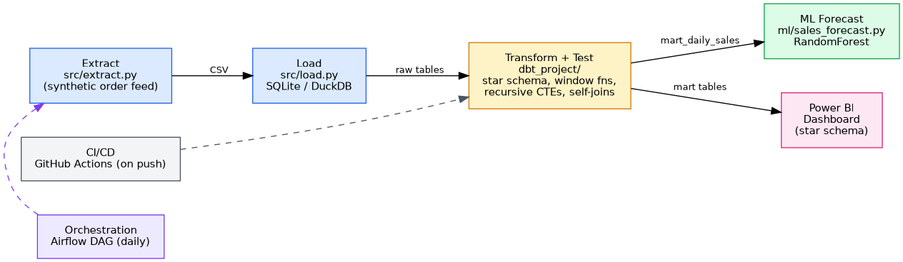

# E-Commerce ELT Data Pipeline

An end-to-end **ELT data pipeline** for an e-commerce business: raw transactional
data is extracted, loaded into an analytical warehouse, transformed into a
dimensional (star schema) model with **advanced SQL** (window functions,
recursive CTEs, self-joins, SQL-only pivoting) and automated data-quality
tests, orchestrated on a schedule, forecasted with a machine learning model,
and served to a Power BI dashboard.

Built to demonstrate the modern data engineering stack end-to-end — extraction,
warehousing, transformation, orchestration, testing, and delivery — not just
one piece of it.

**Note on scope:** this is a pure data-engineering/infrastructure project
(pipeline, warehouse, orchestration). It's deliberately separate from
analytics-style work like customer segmentation or churn modeling — that
kind of analysis belongs in a dedicated ML/analytics project, not duplicated
here.

## Architecture



Extract → Load → Transform (dbt, with tests) fans out to the ML forecast
and the Power BI dashboard. An Airflow DAG runs the whole chain daily;
GitHub Actions runs the pipeline + test suite on every push.

## Tech stack & why

| Layer | Tool | Why |
|---|---|---|
| Extraction | Python | Simulates a real source feed (orders, customers, products) with realistic weekday/festive seasonality — no external API dependency, so anyone can clone and run it |
| Warehouse | SQLite (demo) / **DuckDB** (production path) | DuckDB is the modern embedded OLAP engine used widely in the current "small data" / local-first data stack; SQLite keeps the repo runnable with zero installs |
| Transformation | **dbt-core** | Industry-standard transformation layer — version-controlled SQL, built-in testing, lineage, documentation. This is the single most in-demand DE skill right now |
| Orchestration | **Apache Airflow** | Industry-standard scheduler; DAG defines extract → load → transform → forecast → export |
| ML | scikit-learn (RandomForest) | Time-based train/test split, recursive multi-step forecasting, feature importance — a small, honest, correctly-evaluated model rather than an overclaimed one |
| BI | Power BI | Star-schema model with DAX measures, built on the mart layer |
| CI/CD | GitHub Actions | Runs the full pipeline + data quality tests on every push |
| Containerization | Docker / docker-compose | Reproducible one-command run |

## Data model (star schema)

- **`dim_customers`** — customer attributes, signup recency
- **`dim_products`** — product catalog with margin
- **`dim_date`** — calendar spine for time intelligence (built via **recursive CTE** in the SQLite path, `generate_series` in the DuckDB/dbt path)
- **`fct_order_items`** — grain: one row per order line item (the core fact table)
- **`mart_daily_sales`** — daily aggregate feeding BI + the forecast model
- **`mart_customer_order_summary`** — per-customer order history (orders, revenue, recency) for the dashboard
- **`mart_sales_trends`** — 7d/30d moving averages, day-over-day growth %, cumulative revenue — all via **window functions**
- **`mart_product_ranking`** — products ranked within category by revenue, with cumulative revenue share (`DENSE_RANK`, windowed `SUM`)
- **`mart_monthly_category_revenue`** — monthly revenue by category, **pivoted with conditional aggregation** (no native PIVOT keyword needed)
- **`mart_market_basket`** — frequently-bought-together product pairs via a **self-join**

See `sql/advanced_sql_showcase.sql` for a standalone, commented reference of
every advanced SQL technique used here (window functions, recursive CTEs,
`RANK`/`DENSE_RANK`/`NTILE`, self-joins, pivoting, CTE vs. subquery, `HAVING`
vs. `WHERE`) — useful for a quick review before a SQL interview round.

## How to run it

### Option A — zero install, runs right now (SQLite path)
```bash
pip install pandas numpy scikit-learn matplotlib   # only these four
python src/extract.py              # generate ~6 months of order data
python src/load.py --engine sqlite # load raw CSVs into warehouse.db
python src/transform_local.py      # build star schema + run DQ checks
python ml/sales_forecast.py        # train model, forecast next 14 days
python src/export_for_powerbi.py   # export mart tables for Power BI
```

### Option B — production path (dbt + DuckDB)
```bash
pip install -r requirements.txt
python src/extract.py
python src/load.py --engine duckdb
cd dbt_project
dbt build --profiles-dir . --target dev   # runs models + all schema tests
cd ..
python ml/sales_forecast.py
python src/export_for_powerbi.py
```

### Option C — Docker (one command)
```bash
docker compose up --build
```

### Tests
```bash
pytest tests/ -v
```

### Orchestration (optional)
Drop `airflow/dags/sales_pipeline_dag.py` into your `$AIRFLOW_HOME/dags`
folder after `pip install apache-airflow` to see it scheduled and run
from the Airflow UI.

## Results (from a sample run)
- 400 customers, 21 products, ~5,800 orders, ~10,200 order line items over 180 days
- All 12 automated data-quality checks pass (referential integrity, uniqueness,
  non-negative revenue, revenue reconciliation, ranking correctness, monotonic
  cumulative revenue, basket self-pair exclusion, date-spine completeness)
- Forecast model: **MAPE ≈ 19%** on a held-out time-based test split, correctly
  learning the weekend demand spike (see `ml/forecast_chart.png`)
- Top basket pairing found: products bought together in 40+ shared orders

## Project structure
```
├── src/                          extract, load, transform (local), export
├── dbt_project/                  staging + mart dbt models, schema tests
├── sql/advanced_sql_showcase.sql  standalone advanced SQL reference/interview prep
├── airflow/dags/                 orchestration DAG
├── ml/                           forecasting model + outputs
├── dashboards/                   Power BI build guide + exported data
├── docs/                         architecture diagram + interview prep notes
├── tests/                        pytest data-quality test suite (12 checks)
├── .github/workflows/ci.yml      CI pipeline
├── Dockerfile / docker-compose.yml / .dockerignore
├── LICENSE
└── requirements.txt
```

## Interview prep
`docs/INTERVIEW_PREP.md` has likely questions and grounded answers for
every design decision in this repo (why dbt, why DuckDB, RANK vs
DENSE_RANK, how to scale it, etc.) — worth a read before a DE interview.

## What I'd do next with more time
- Swap the synthetic generator for a real source (Kaggle Olist dataset or a live API) via an incremental/CDC load pattern instead of full refresh
- Add `dbt snapshot` for slowly-changing customer dimension tracking (SCD2)
- Move orchestration to a managed Airflow (MWAA/Astronomer) or Dagster, with Slack alerting on task failure
- Add Great Expectations for richer data contracts alongside dbt tests
- Swap DuckDB for Snowflake/BigQuery/Postgres for a real multi-user warehouse
